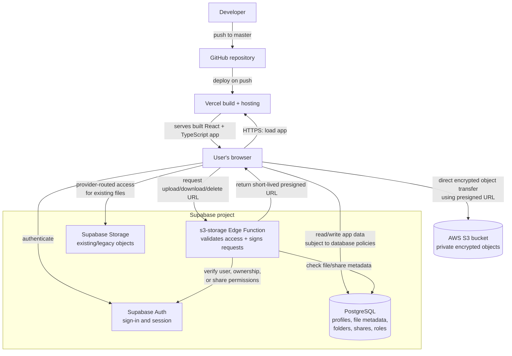

<div align="center">
  
  <h1>EpicBox</h1>
  <p><strong>Your files, organized and within reach.</strong></p>
  <p>A cloud file manager for organizing, previewing, and sharing files.</p>
  <p>
    <a href="https://epicbox.vercel.app/"><strong>Open the app</strong></a>
    &nbsp;·&nbsp;
    <a href="#getting-started">Run locally</a>
    &nbsp;·&nbsp;
    <a href="#storage-configuration">Storage setup</a>
  </p>
  <p>
    
    
    
    
    
  </p>
</div>

---

## Contents

- [Overview](#overview)
- [Features](#features)
- [Technology](#technology)
- [Architecture](#architecture)
- [How storage works](#how-storage-works)
- [Getting started](#getting-started)
- [Storage configuration](#storage-configuration)
- [Environment variables](#environment-variables)
- [Database and deployment](#database-and-deployment)
- [Development checks](#development-checks)
- [Project structure](#project-structure)
- [Security notes](#security-notes)

## Overview

EpicBox is a web-based cloud file manager built with React, Supabase, and
Amazon S3. Private S3 is the primary object-storage target; Supabase Storage
support remains for files stored there previously. The app is deployed on
[Vercel](https://epicbox.vercel.app/); source code is hosted in
[Deepparmar07/Epicbox](https://github.com/Deepparmar07/Epicbox).

## Features

| Organize | Share | Manage |
| --- | --- | --- |
| Upload, search, preview, and sort files | Create expiring or password-protected links | Sign in and recover accounts with Supabase Auth |
| Create folders and browse file categories | Choose whether recipients can download | Apply user/admin roles and database access policies |
| Keep favorites and revisit recent files | Share a QR code and view access statistics | Use a recycle bin, settings, and theme controls |

Files are encrypted in the browser with AES-GCM before upload and stored in a
private AWS S3 bucket. Existing Supabase Storage files remain supported.

## Technology

- React 18, TypeScript, Vite, and React Router
- Tailwind CSS, Radix UI, and Lucide icons
- Supabase Auth, PostgreSQL, Storage, and Edge Functions
- AWS S3 with short-lived presigned URLs
- Vercel

## Architecture



Each file record tracks its storage provider so the application routes files
to the provider where they were uploaded.

## How storage works

The browser encrypts a file before uploading it. Supabase stores account data,
file metadata, folder relationships, and sharing records. Each file record
tracks its storage provider so the app can continue routing older files to
Supabase Storage while newer files use S3.

For S3, the browser first asks the `s3-storage` Supabase Edge Function for a
short-lived presigned URL. The function validates the signed-in user and
checks ownership or share-link permissions before issuing an upload,
download, or delete URL. The browser then transfers the encrypted object
directly to the private S3 bucket. Presigned URLs expire after five minutes.

This is browser-side encryption, not an end-to-end encryption guarantee:
`VITE_ENCRYPTION_KEY` is included in the frontend build. Do not claim that this
key is hidden from users or that it provides private per-user key management.

## Getting started

### Requirements

- Node.js 20 or later
- npm 10 or later
- A Supabase project

### Install and run

1. Install dependencies:

   ```sh
   npm install
   ```

2. Copy `.env.example` to `.env` and set the values for your Supabase project:

   ```dotenv
   VITE_SUPABASE_URL=https://your-project-ref.supabase.co
   VITE_SUPABASE_PUBLISHABLE_KEY=your-supabase-publishable-key
   VITE_STORAGE_PROVIDER=s3
   VITE_ENCRYPTION_KEY=your-encryption-key
   ```

3. Configure the S3 bucket, IAM policy, Edge Function, and secrets as described
   below before using `VITE_STORAGE_PROVIDER=s3`. If S3 is not configured in a
   local environment yet, use `VITE_STORAGE_PROVIDER=supabase` there.
4. Apply the SQL migrations in `supabase/migrations/` to the intended Supabase
   project, in filename order. The current migration sequence is:

   | Migration | Purpose |
   | --- | --- |
   | `00001_create_initial_schema.sql` | Core tables, policies, functions, and storage setup |
   | `00002_add_terabox_features.sql` | File-management features and related schema |
   | `00003_fix_profile_creation.sql` | Profile creation trigger repair |
   | `00004_repair_profile_trigger.sql` | Follow-up repair for profile creation |
   | `00005_backfill_missing_profiles.sql` | Restore profiles for existing auth users |
   | `00006_handle_duplicate_signup_usernames.sql` | Handle duplicate usernames during signup |
   | `00007_grant_authenticated_app_table_access.sql` | Grant required table privileges |
   | `00008_allow_encrypted_file_uploads.sql` | Allow encrypted object uploads to Supabase Storage |
   | `00009_track_file_storage_provider.sql` | Track whether each file is in Supabase or S3 |

   Run each migration once, in order, against the correct Supabase project.
5. Start the local development server:

   ```sh
   npm run dev
   ```

The app uses hash-based routes. The login page is available at `/#/login`.

New accounts use Supabase Auth; a database trigger creates the associated
profile. Do not add client-side profile creation to signup. When moving to a
different Supabase project, authentication accounts, metadata, and stored
objects are not automatically transferred.

## Storage configuration

### Supabase Storage compatibility

Existing files in Supabase Storage remain accessible. Set
`VITE_STORAGE_PROVIDER=supabase` only for environments that should send new
uploads to Supabase Storage instead of S3.

### AWS S3

AWS S3 is EpicBox's primary object-storage target. The bucket must remain
private; EpicBox accesses it through short-lived URLs issued by the
`s3-storage` Supabase Edge Function. AWS credentials belong only in Supabase
Edge Function secrets—not in frontend `VITE_*` variables, source code, or chat.

1. Create a private S3 bucket. Keep **Block all public access** enabled.
2. Configure bucket CORS for the application origins. For production, use:

   ```json
   [
     {
       "AllowedHeaders": ["*"],
       "AllowedMethods": ["PUT", "GET", "DELETE"],
       "AllowedOrigins": ["https://epicbox.vercel.app"],
       "ExposeHeaders": ["ETag"],
       "MaxAgeSeconds": 3000
     }
   ]
   ```

3. Create a dedicated IAM identity with only the object permissions EpicBox
   needs, scoped to the bucket. Do not attach `AmazonS3FullAccess`:

   ```json
   {
     "Version": "2012-10-17",
     "Statement": [
       {
         "Effect": "Allow",
         "Action": [
           "s3:PutObject",
           "s3:GetObject",
           "s3:DeleteObject"
         ],
         "Resource": "arn:aws:s3:::YOUR_BUCKET_NAME/*"
       }
     ]
   }
   ```

   Add a local origin only when needed for development. CORS permits browser
   requests; it does not make the bucket public.
4. In Supabase **Edge Functions → Secrets**, set:
   - `S3_BUCKET`
   - `AWS_REGION`
   - `AWS_ACCESS_KEY_ID`
   - `AWS_SECRET_ACCESS_KEY`

   Supabase supplies its project URL and service credentials to the Edge
   Function at runtime. For local development, copy
   `supabase/functions/.env.example` to `supabase/functions/.env`, fill in the
   bucket and restricted IAM credentials, then run:

   ```sh
   npx supabase functions serve s3-storage --env-file supabase/functions/.env
   ```

   The local `.env` file is ignored by Git. Do not commit AWS credentials or
   put them in the frontend `.env` file.
5. Deploy the Edge Function to the same Supabase project used by the app:

   ```sh
   npx supabase login
   npx supabase functions deploy s3-storage --project-ref YOUR_PROJECT_REF
   ```

6. Apply migration `00009_track_file_storage_provider.sql` if it has not
   already been applied.
7. After verifying the function, secrets, bucket CORS, and IAM policy, set
   `VITE_STORAGE_PROVIDER=s3` in Vercel and redeploy the frontend. Keep this
   setting enabled in the production environment to use S3 for new uploads.
8. Test a new upload, download, preview, share link, and deletion. Existing
   Supabase objects are not automatically copied to S3.

If S3 returns an error, inspect the failed request's response body for its
error code. `AccessDenied` usually indicates IAM or bucket-policy permissions;
`SignatureDoesNotMatch` can indicate an incorrect key pair or region. Never
share a presigned URL: it is a temporary credential.

Enable S3 versioning to help recover overwritten or deleted objects. For an
independent backup, configure replication or scheduled copies to a separate
bucket or account, and periodically test restoring an object.

## Environment variables

| Variable | Required | Description |
| --- | --- | --- |
| `VITE_SUPABASE_URL` | Yes | URL of the Supabase project |
| `VITE_SUPABASE_PUBLISHABLE_KEY` | Yes | Supabase publishable key |
| `VITE_SUPABASE_ANON_KEY` | Legacy | Legacy publishable/anon key name supported by existing deployments |
| `VITE_STORAGE_PROVIDER` | Yes for S3 | `s3` for primary object storage; `supabase` for Supabase Storage environments |
| `VITE_ENCRYPTION_KEY` | For existing encrypted data | Browser-side AES-GCM encryption key |
| `S3_BUCKET` | Yes for S3 | Private S3 bucket name; configure as an Edge Function secret |
| `AWS_REGION` | Yes for S3 | AWS region containing the bucket; configure as an Edge Function secret |
| `AWS_ACCESS_KEY_ID` | Yes for S3 | Restricted IAM access key; server-side only |
| `AWS_SECRET_ACCESS_KEY` | Yes for S3 | Restricted IAM secret key; server-side only |

Vite embeds `VITE_*` values in the client bundle. In particular,
`VITE_ENCRYPTION_KEY` is **not a server-only secret**. Changing it can prevent
previously encrypted files from being decrypted. Keep the same value for
existing data and do not treat it as a secure key-management system. S3
settings are intentionally kept out of the frontend `.env.example`: use
`supabase/functions/.env.example` for local Edge Function development and set
the production values in Supabase **Edge Functions → Secrets**.

## Database and deployment

Apply all migrations in `supabase/migrations/` in order as listed above. They
define the application schema, access policies, profile recovery, encrypted
uploads, and per-file storage-provider tracking. Use the SQL Editor in the
correct Supabase project and verify each migration before continuing.

Connect Vercel to [Deepparmar07/Epicbox](https://github.com/Deepparmar07/Epicbox)
and use `master` as the production branch. Configure:

- Build command: `npm run build`
- Output directory: `dist`
- Production branch: `master`

Set `VITE_SUPABASE_URL`, `VITE_SUPABASE_PUBLISHABLE_KEY`,
`VITE_STORAGE_PROVIDER`, and `VITE_ENCRYPTION_KEY` in the appropriate Vercel
environments. Redeploy after changing a `VITE_*` value. Do not put AWS
credentials in Vercel.

The application uses hash-based client routes. `vercel.json` includes the
rewrite configuration required for clean entry URLs such as `/login`.

The `supabase/reset-data.sql` script is destructive: it removes application
data and storage objects. Review it carefully and run it only when you
intentionally want to reset the correct project.

## Development checks

```sh
npm run lint
npm run build
```

`npm run lint` runs the project TypeScript check followed by Biome.
`npm run build` creates the production bundle in `dist/`.

## Project structure

```text
src/
  components/       Shared UI, file, and layout components
  contexts/         Authentication and application state
  db/               Supabase client and data-access APIs
  hooks/            Reusable React hooks
  lib/              Encryption, file utilities, and storage providers
  pages/            Route-level screens
  types/            Shared TypeScript types
  routes.tsx        Application route definitions
supabase/
  functions/        Supabase Edge Functions
  migrations/       Ordered database and security migrations
  reset-data.sql    Optional destructive data reset script
docs/
  prd.md            Product requirements and design reference
vercel.json         Vercel SPA rewrite configuration
```

## Security notes

- Never commit `.env`, AWS access keys, Supabase service-role keys, or tokens.
- Keep Supabase row-level security enabled for application tables.
- Keep the S3 bucket private and grant only the required IAM permissions.
- Browser-side encryption does not replace TLS, access controls, backups, or
  secure management of encryption keys.
